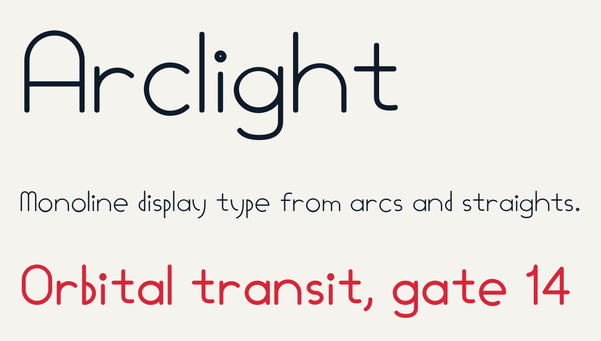
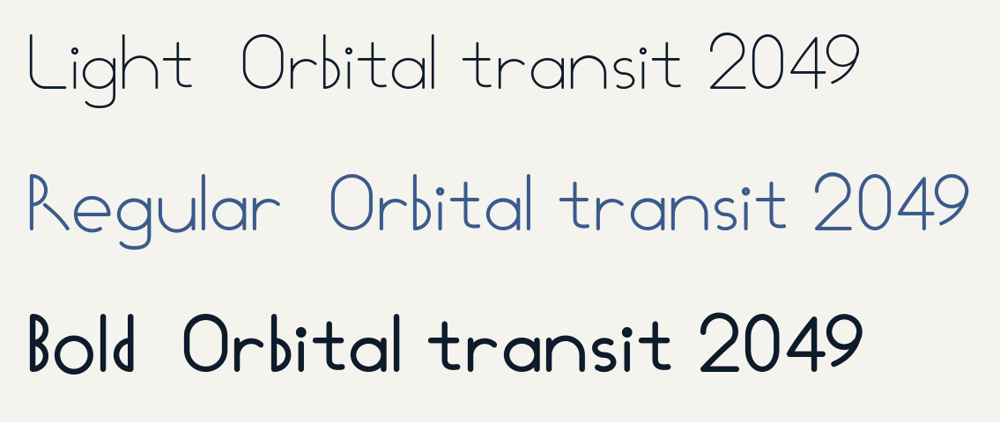
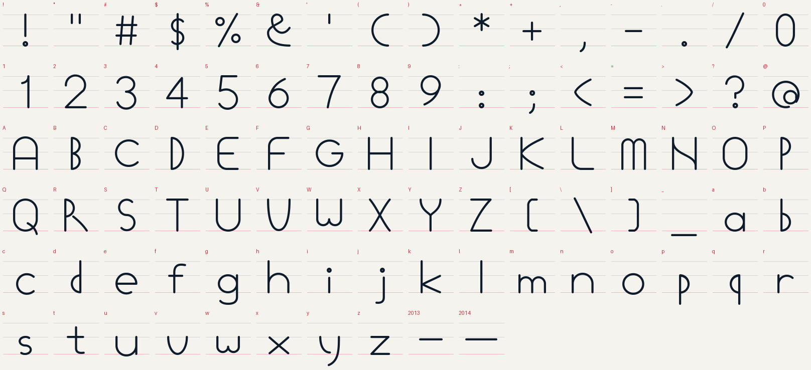

# Arclight



Arclight is a monoline display typeface built from arcs and straights only. Every glyph is a single centre line stroked with round caps and round joins, so the face has one stroke thickness everywhere: no contrast, no corners, and no counters cut by hand. It comes in three weights, Light, Regular and Bold, all stroked from the same skeletons.

**[Download the fonts](https://github.com/q78717/font-arclight/releases/latest)** · open `documentation/specimen/index.html` for the interactive specimen

## Weights



| Style | Weight | Stroke (design units) |
|---|---|---|
| Light | 300 | 5.0 |
| Regular | 400 | 7.5 |
| Bold | 700 | 12.0 |

## Character set

The 91 characters cover basic Latin letters, figures, and common punctuation and symbols. There are no accented letters yet. Arclight is a display face, and it reads best at 24 px and up.



## Using the fonts

**Desktop:** download the latest release and install the `.ttf` files.

**Web:** use the `.woff2` files.

```css
@font-face {
  font-family: "Arclight";
  src: url("Arclight-Regular.woff2") format("woff2");
  font-weight: 400;
  font-display: swap;
}
/* repeat for 300 (Light) and 700 (Bold) */
```

## Building from source

Every glyph is an SVG path on a 200-unit design grid in `sources/build_arclight.py`. The script strokes each path with `skia-pathops` at three widths and writes the Light, Regular and Bold UFO sources in `sources/ufo/`. [gftools builder](https://github.com/googlefonts/gftools) then compiles and hints the fonts. The repository follows the [Google Fonts project template](https://github.com/googlefonts/googlefonts-project-template), and the shared targets and workflows come from [font-tools](https://github.com/q78717/font-tools).

```sh
make build    # sets up the venv (../.venv-fonts if present, else venv/), then runs sources/build.sh
make test     # checks the fonts with fontspector (cargo binstall fontspector)
make qa       # checks the fonts with FontBakery (googlefonts + universal profiles)
make proof    # HTML proofs in out/proof (cargo binstall diffenator3)
make images   # redraws the PNG images in documentation/
```

`sources/build.sh` runs the whole build in one command:

1. It writes `sources/ufo/`.
2. It compiles `sources/config.yaml` into `fonts/ttf/` and `fonts/webfonts/`.
3. It adds a `STAT` table.
4. It rebuilds `documentation/specimen/index.html`.
5. It runs `font-tools check-font` and writes the findings to `out-check-font.txt`. See DESIGN.md for the open findings.

Dependencies are listed in `requirements.in`, and `make update` regenerates the pinned `requirements.txt`. FontBakery uses a separate environment built from `requirements-qa.txt`.

## Licence

Copyright 2026 The Arclight Project Authors. Arclight is licensed under the [SIL Open Font License 1.1](OFL.txt). You can use, modify, and redistribute it freely, including commercially, but you may not sell the fonts on their own.
